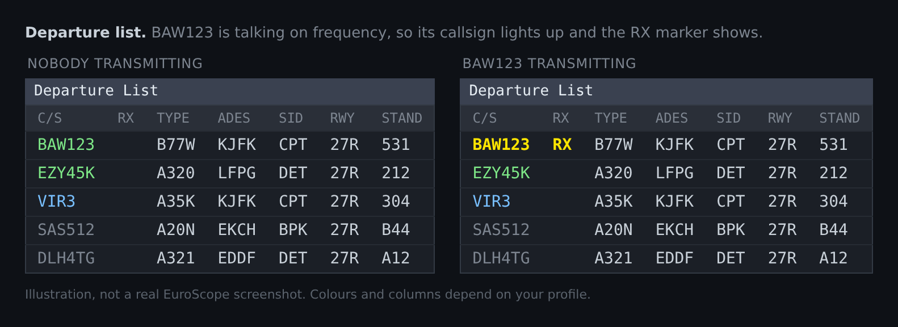
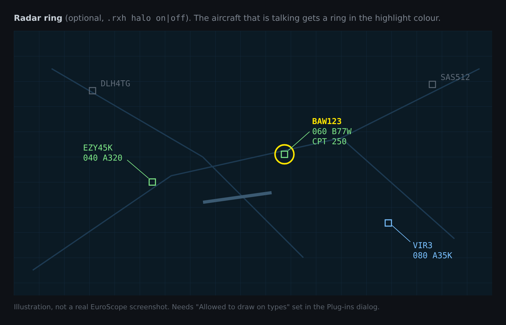
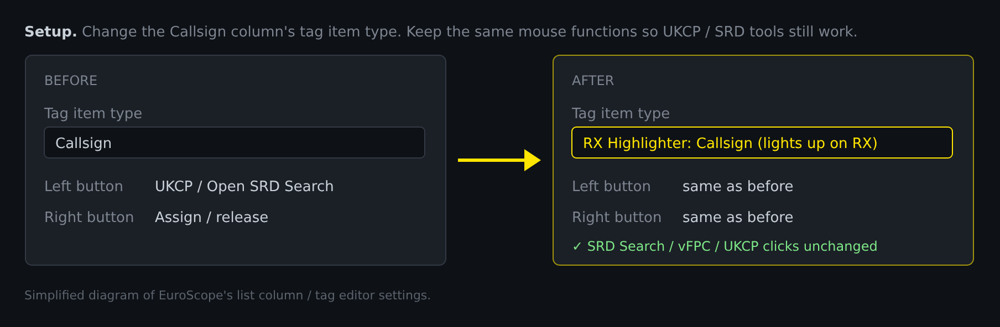
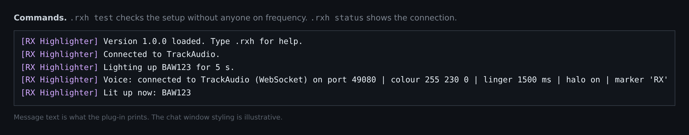

# RX Highlighter – EuroScope plug-in

Makes an aircraft's callsign **light up** in your EuroScope lists (departure list, arrival list,
SIL, etc.) and tags **while that pilot is talking on frequency**. It can also draw a ring
around the aircraft on the radar.





<sub>These images are illustrations of the plug-in's behaviour, not real EuroScope screenshots.
Colours and columns depend on your profile. Source: `docs/images/illustrations.html`.</sub>

It gets "who is transmitting" from your voice client:

| Voice client | How |
|---|---|
| **TrackAudio** (recommended) | WebSocket `ws://127.0.0.1:49080/ws`, `kRxBegin` / `kRxEnd` events |
| Older AFV-compatible clients | Falls back to polling `http://127.0.0.1:49080/transmitting` |

Nothing to configure. Start TrackAudio and the plug-in connects by itself and reconnects if
TrackAudio is restarted.

## Works alongside VATSIM UK's plug-ins

Built to load next to **UK Controller Plugin (UKCP)** and the SRD tools
(**vFPC** and UKCP's **SRD Search**):

* Same EuroScope SDK (compatibility code 16) and the same 32-bit build as UKCP.
  `scripts/fetch-sdk.ps1` downloads the SDK from the UKCP repository.
* Own command prefix (`.rxh`), so it never takes `.ukcp` or `.vfpc` commands.
* Own tag items, all prefixed `RX Highlighter:`. EuroScope scopes item IDs per plug-in,
  so they can't clash with UKCP or vFPC items.
* Its radar drawing adds **no clickable screen objects**, so it can't steal clicks, menus or
  ASR settings from UKCP or vFPC.
* Never calls EuroScope from its background thread. The network thread only touches its own
  data, and unloading or closing EuroScope takes well under a second.
* No conflicting settings keys (`RxColour`, `RxLingerMs`, `RxHalo`, `RxMarker`, `RxPort`).
* Talks only to `127.0.0.1:49080`, as a client. Neither UKCP nor vFPC uses that port.

## Install

1. Copy `RxHighlighter.dll` somewhere stable, e.g. next to your other plug-ins in the UK
   controller pack (`...\UK\Data\Plugin\`).
2. EuroScope → **OTHER SET → Plug-ins… → Load** → choose `RxHighlighter.dll`.
   UKCP and vFPC stay loaded as normal. Load order does not matter.
3. For the radar ring, select RX Highlighter in the Plug-ins dialog and add your display type
   (e.g. `Standard ES radar screen`) to **Allowed to draw on types**.
4. Save your profile/plug-in settings when EuroScope asks, so the plug-in loads next time.

## Make the list line light up

EuroScope doesn't let plug-ins recolour EuroScope's own built-in columns. Instead, this
plug-in provides a callsign column that changes colour itself:



1. Open the list (e.g. Departure List) → click the list's header menu → **Columns setup**
   (or the tag editor for radar tags).
2. Select the **Callsign** column and change its *Tag item type* to
   **`RX Highlighter: Callsign (lights up on RX)`**.
3. **Set the column's left/right mouse-button functions to what they were before.** This is
   what keeps your SRD and UKCP tools working. For example, keep "Open SRD Search" from UKCP,
   or your vFPC / flight-plan functions, on the same button. Tag functions belong to the
   column, not the item type, so they work on this item exactly as before.
4. Optional: add a narrow column with **`RX Highlighter: Transmitting marker`**. It shows
   `RX` while the aircraft is transmitting.

When the pilot isn't transmitting, the callsign keeps EuroScope's normal colour (assumed,
notified, etc.). Only while they're on frequency does it change to the highlight colour.

Check your setup without anyone talking: `.rxh test BAW123` lights up BAW123 for 5 seconds.

## Commands



| Command | |
|---|---|
| `.rxh` | Help |
| `.rxh status` | Connection state, settings and who is lit up |
| `.rxh colour R G B` | Highlight colour (default `255 230 0`, bright yellow) |
| `.rxh linger MS` | Stay lit for MS after the transmission ends (default 1500, 0–10000) |
| `.rxh halo on\|off` | Ring around the aircraft on the radar (default on) |
| `.rxh marker TEXT` | Text shown by the marker item (default `RX`) |
| `.rxh port N` | Voice client port (default 49080) |
| `.rxh test CALLSIGN [SEC]` | Pretend CALLSIGN is transmitting (1–60 s, default 5) |

## Limitations

* **Up to about 1 second of delay.** EuroScope gives plug-ins a 1-second timer to trigger a
  redraw, so the highlight appears within about a second of the pilot keying up. The default
  1.5 s linger makes sure even a quick "roger" is shown.
* Highlights the **text colour** of the item. Plug-ins can't change a list row's background.
* Matches on network callsign, so it lights up anyone you **receive** in TrackAudio, on any
  of your RX frequencies.
* Controllers who transmit (e.g. `EGLL_N_TWR`) have no flight plan, so nothing lights up for them.

## Build

Needs Windows with Visual Studio 2022 (Desktop development with C++) and CMake.

```powershell
./scripts/build.ps1
```

This downloads the EuroScope SDK, builds a **32-bit** release DLL, runs the unit tests and
prints the path to `build\Release\RxHighlighter.dll`.

Manual build:

```powershell
./scripts/fetch-sdk.ps1
cmake -S . -B build -G "Visual Studio 17 2022" -A Win32
cmake --build build --config Release
```

If you push this to GitHub, `.github/workflows/build.yml` builds the DLL on every push. Get
it from the workflow run's *Artifacts*.

## Layout

```
src/dllmain.cpp            EuroScope entry points
src/RxHighlightPlugin.*    Tag items, commands, settings, 1 s refresh
src/RxRadarScreen.*        Optional ring around transmitting aircraft
src/VoiceClient.*          Background Winsock client (WebSocket, then HTTP fallback)
src/WebSocketCodec.*       Minimal RFC 6455 framing + HTTP response parsing
src/VoiceMessage.*         TrackAudio JSON message parsing
src/RxState.*              Thread-safe "who is transmitting" state
test/test_main.cpp         Unit tests (portable)
```
